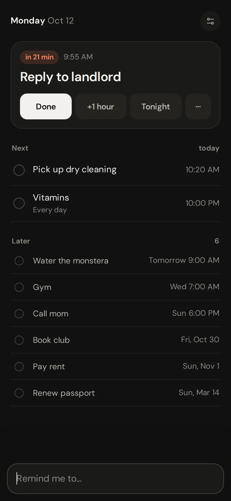
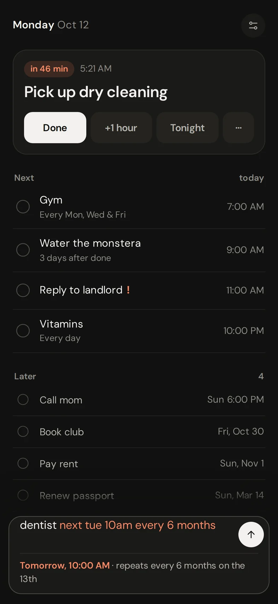
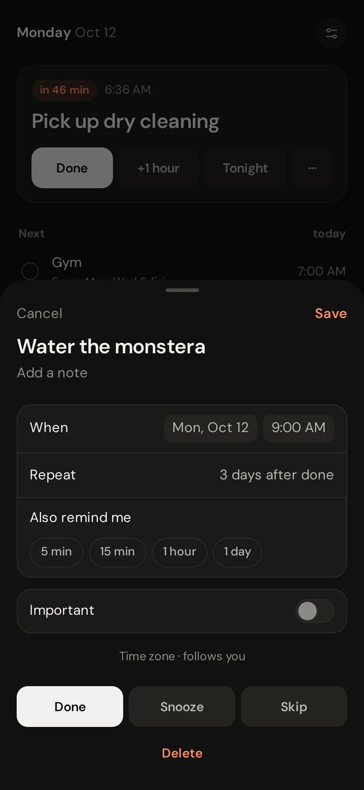
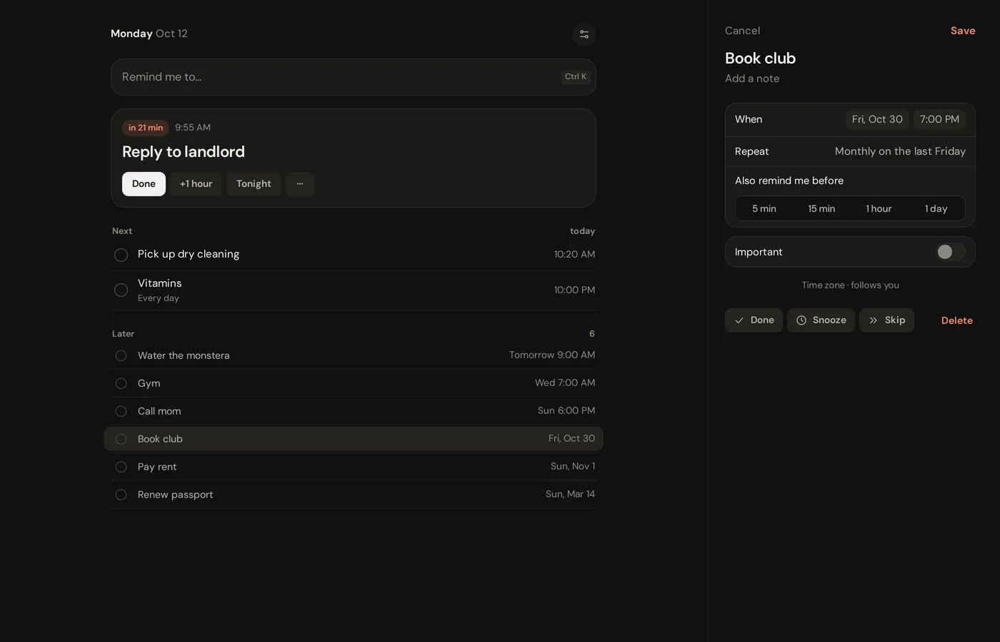

# Nudge

Personal reminders that show up on time. An installable PWA for iPhone, Mac and Windows, running on one Cloudflare Worker and one SQLite Durable Object per person.

<p>
  
  
  
</p>
<p>
  
</p>

- Type it like you'd say it: "book club last fri of the month 7pm".
- Real calendar repeats, plus "every 3 days after done".
- Web Push on time, with retries and Telegram alerts if something's off.
- Local first, works offline.

## Deploy

```sh
bun install
bun run deploy --name <worker-name>
bun run secrets <worker-name>
```

For Telegram alerts, export `TELEGRAM_BOT_TOKEN` and `TELEGRAM_CHAT_ID` before `secrets`. Then open the Worker's URL, install it, and enter the setup code it printed. Add more devices from Settings. On Windows 11, Settings also offers an installable app.
